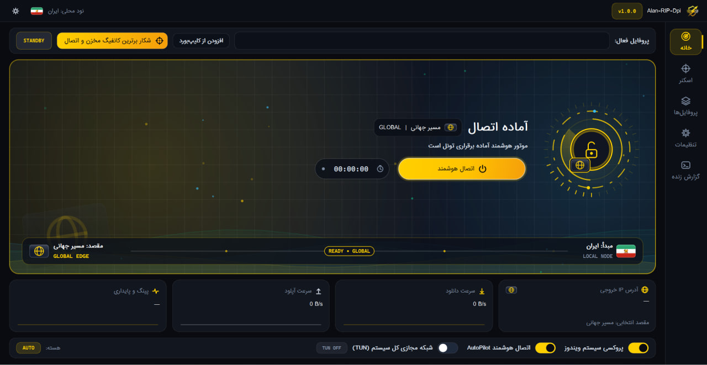

<div align="center">

# Alan-RIP-Dpi — Windows

**کلاینت دسکتاپ مهندسی‌شده جهت دور زدن بازرسی عمیق بسته (DPI) و مدیریت هوشمند تونل شبکه در ویندوز**


[**دانلود آخرین نسخه (Releases)**](../../releases) · [**گزارش باگ و پیشنهاد**](../../issues) · [**کانال تلگرام (@LabAlan)**](https://t.me/LabAlan)

<br>



</div>

---

<div dir="rtl">

## فهرست مطالب

| بخش | توضیحات |
| :--- | :--- |
| [۱. معرفی اجمالی](#معرفی-اجمالی) | معماری سیستم، متدولوژی ابداعی ضد DPI و موتور تصمیم‌گیرنده AutoPilot |
| [۲. قابلیت‌های کلیدی](#قابلیت‌های-کلیدی) | مشخصات فنی، پروتکل‌های پشتیبانی‌شده و سامانه پایش پایداری |
| [۳. دانلود و شروع سریع](#دانلود-و-شروع-سریع) | راهنمای استقرار نسخه پرتابل و راه‌اندازی اولیه بدون نیاز به پیش‌نیاز |
| [۴. ساخت از سورس](#ساخت-از-سورس) | کامپایل پروژه، وابستگی‌های Python 3.13 و اسکریپت‌های اتوماسیون بیلد |
| [۵. معماری و تنظیمات پیشرفته](#معماری-ماژولار-و-تنظیمات-پیشرفته) | ساختار درختی کدها، ماژول‌های هسته و پیکربندی فرگمنت بومی |
| [۶. پرسش‌های رایج و رفع مشکل](#پرسش‌های-رایج-و-رفع-مشکل) | عیب‌یابی پورت‌ها، دسترسی‌های سطح سیستم‌عامل و پایداری لبه شبکه |
| [۷. قدردانی](#قدردانی) | تقدیر از مشارکت‌کنندگان فنی و پروژه‌های زیرساختی |
| [۸. مجوز و ارتباط](#مجوز-و-ارتباط) | قوانین کپی‌رایت، شرایط انتشار و کانال رسمی تلگرام |

---

## معرفی اجمالی

پروژه **Alan-RIP-Dpi** یک کلاینت دسکتاپ یکپارچه و سطح بالا برای سیستم‌عامل ویندوز است که بر پایه **Python 3.13**، فریم‌ورک گرافیکی **PySide6** و هسته قدرتمند **Xray** توسعه یافته است. هدف اصلی این نرم‌افزار، ایجاد یک لایه ارتباطی فوق‌پایدار، مقاوم در برابر اختلالات شبکه و بی‌نیاز از پیکربندی‌های دستی پیچیده در محیط‌های دارای فیلترینگ شدید و سیستم‌های بازرسی عمیق بسته (DPI) است.

نقطه تمایز اصلی این پروژه، به‌کارگیری یک **روش ابداعی و اختصاصی در لایه انتقال داده** است که برخلاف ابزارهای مرسوم (که صرفاً به تقطیع ساده و ایستای بسته‌ها بسنده می‌کنند)، رفتار ترافیکی تونل را به‌صورت پویا با وضعیت لحظه‌ای فایروال تطبیق می‌دهد تا اتصالی بدون نوسان، مقاوم در برابر مسدودسازی‌های زمان‌مند و کاملاً پایدار در جلسات طولانی‌مدت فراهم گردد.

معماری این نرم‌افزار بر چهار رکن مهندسی استوار است:
1. **متدولوژی ابداعی عبور از DPI (Proprietary Anti-DPI Engine):** تلفیق تکنیک اختصاصی **Adaptive Core Stride** و تزریق هدفمند **Urgent Pointer** در کنار فرگمنت بومی هسته، که الگوهای تشخیص امضای پروتکل و استخراج SNI در تجهیزات بازرسی بسته را خنثی کرده و مانع از افت سرعت یا قطع شدن متناوب اتصال (Connection Throttling/Drop) می‌شود.
2. **موتور تصمیم‌گیرنده خودکار (AutoPilot Engine):** مدیریت هوشمند چرخه حیات اتصال، ارزیابی بلادرنگ کیفیت مسیرها و سوئیچینگ بدون قطعی در پس‌زمینه.
3. **لایه شبکه مجازی سراسری (System-wide TUN):** پیاده‌سازی رابط شبکه مجازی در سطح کرنل مبتنی بر درایور **Wintun** جهت هدایت شفاف تمام ترافیک TCP/UDP سیستم‌عامل به درون هسته Xray بدون نیاز به تنظیم پروکسی در تک‌تک برنامه‌ها.
4. **اسکنر چندرنجی کلودفلر (Multi-Range Edge Scanner):** کاوشگر موازی زیرشبکه‌های Anycast کلودفلر جهت کشف آی‌پی‌های تمیز با کمترین میزان جیتر (Jitter) و اتلاف بسته (Packet Loss).

| مشخصه فنی | پیاده‌سازی در Alan-RIP-Dpi |
| :--- | :--- |
| **زبان و رابط کاربری** | Python 3.13 + PySide6 (Qt6 Native Rendering) |
| **هسته مرکزی تونل و مسیریابی** | Xray-core (پشتیبانی کامل از TLS / Reality / Native Fragment) |
| **لایه شبکه مجازی (TUN)** | Wintun Virtual Kernel Adapter + Native Packet Forwarder |
| **مکانیزم اختصاصی پایداری** | متد ابداعی Adaptive Core Stride & Urgent Pointer + پایشگر بلادرنگ |

---

## قابلیت‌های کلیدی

* **اتصال هوشمند تک‌کلیکی (Zero-Touch AutoPilot):** حذف کامل فرآیندهای آزمون‌وخطای دستی؛ نرم‌افزار پس از اجرا به‌صورت خودکار رفتار شبکه اپراتور را تحلیل کرده، تمیزترین لبه شبکه را یافته و بهینه‌ترین پارامترهای عبور از فیلترینگ را اعمال می‌کند.
* **پایداری تضمین‌شده با الگوریتم تطبیقی:** بهره‌گیری از متد ابداعی پروژه در تغییر پویای گام‌های ارسال بسته، که از شناسایی جریان داده در استفاده‌های طولانی‌مدت (مانند دانلودهای حجیم، جلسات کاری آنلاین و استریم زنده) جلوگیری می‌کند.
* **تست پایداری واقعی ۶ ثانیه‌ای (Real-World Throughput Benchmark):** برخلاف کلاینت‌های متداول که صرفاً به پینگ TCP یا اتصال اولیه اکتفا می‌کنند، موتور ارزیابی Alan-RIP-Dpi پیش از تایید نهایی اتصال، یک تست بارگذاری ۶ ثانیه‌ای شامل شبیه‌سازی استریم ویدیویی یوتیوب و نرخ آپلود پایدار را اجرا می‌کند تا از عدم فریز شدن تونل اطمینان حاصل شود.
* **پشتیبانی جامع از پروتکل‌های استاندارد:** سازگاری کامل هسته Xray با ساختارهای **VLESS**، **VMess**، **Trojan** و **Shadowsocks** بر بسترهای انتقال TCP، WebSocket (WS)، gRPC و HTTPUpgrade.
* **حالت TUN سطح سیستم‌عامل:** مسیریابی ترافیک تمامی نرم‌افزارها، بازی‌ها و ابزارهای خط فرمان از طریق آداپتور مجازی Wintun با مدیریت خودکار جداول مسیریابی (Routing Tables) و جلوگیری از نشت DNS (DNS Leak Prevention).
* **نگه‌بان خودترمیم‌گر (Self-Healing Watchdog):** پایش مستمر سلامت تونل در پس‌زمینه؛ در صورت تشخیص افت توان عملیاتی، اختلال در IP لبه یا توقف پردازش هسته، سیستم بدون دخالت کاربر ظرف چند میلی‌ثانیه مسیر ارتباطی را بازسازی و جایگزین می‌کند.
* **بازگردانی ایمن وضعیت شبکه (Safe Rollback):** پاکسازی تضمینی تنظیمات پروکسی ویندوز و اینترفیس‌های شبکه مجازی در صورت خروج عادی یا بسته شدن ناگهانی برنامه.

---

## دانلود و شروع سریع

برای اجرای نسخه آماده بدون نیاز به نصب پایتون یا کامپایل سورس، مراحل زیر را به ترتیب دنبال کنید:

۱. به بخش [Releases](../../releases) مخزن مراجعه کرده و آخرین نسخه آرشیو پرتابل (`Alan-RIP-Dpi-v1.0.0-Windows-x64-portable.zip`) را دانلود کنید (توصیه می‌شود هش فایل را با `SHA256SUMS.txt` تطبیق دهید).
۲. محتویات فایل فشرده را در یک مسیر دلخواه (ترجیحاً خارج از پوشه‌های سیستمی محدودشده مانند `Program Files`) استخراج کنید.
۳. فایل اجرایی هسته `xray.exe` (و فایل‌های داده `geoip.dat` و `geosite.dat` جهت قواعد مسیریابی) را دانلود کرده و دقیقاً در پوشه `core` در کنار دایرکتوری اصلی برنامه قرار دهید:

</div>

```text
Alan-RIP-Dpi/
├── Alan-RIP-Dpi.exe
├── core/
│   ├── xray.exe
└── config/
