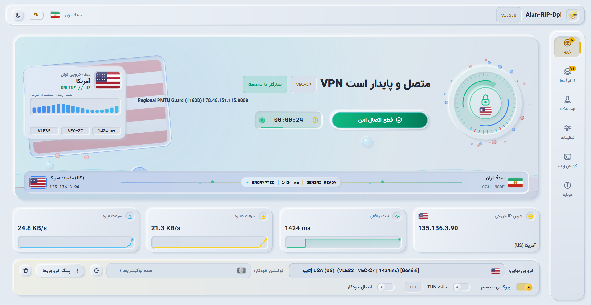

<div align="center">
  
  <h1>Alan-RIP-Dpi (Windows Desktop) — v1.6.1</h1>
  <p><b>Adaptive Anti-DPI Engine, Pro NetOps 5-Tab Control Center, Super DNS Lab, Low-RAM Core & Xray Routing Client for Windows</b></p>
  <p>
    <a href="https://github.com/DrAlanK/Alan-RIP-Dpi-Windows/releases/latest">Download Latest Release (v1.6.1)</a>
    ·
    <a href="https://github.com/DrAlanK/Alan-RIP-Dpi-Android">Android Version (Alan-RIP-Dpi-Android)</a>
    ·
    <a href="https://t.me/LabALan">Telegram Channel (@LabALan)</a>
  </p>
</div>

---

## معرفی اجمالی و تجربه کاربری (غیرفنی)

**Alan-RIP-Dpi** یک کلاینت دسکتاپ متن‌باز، سبک و مهندسی‌شده برای ویندوز مبتنی بر هسته **Xray-core** است که پیچیدگی‌های فنی دور زدن فیلترینگ (DPI)، مقابله با مسمومیت DNS، رفع قفل شدن آپلود و سیاه‌چاله‌های PMTU منطقه‌ای، تفکیک برنامه‌ها و بهینه‌سازی مصرف سخت‌افزار را در یک رابط کاربری **Liquid Glass ذغالی-طلایی** گرد هم آورده است:

- **مرکز تنظیمات مهندسی شبکه (Pro NetOps — ۵ تب تخصصی):** شامل ۳ پروفایل آماده یک‌کلیکی (**تعادل**، **فوق‌سبک و کم‌مصرف**، **نهایت سرعت و گیمینگ**) به همراه دکمه **«ذخیره و اعمال فوری (Hot-Reload)»** برای بروزرسانی لحظه‌ای اتصال فعال بدون قطع و وصل دستی.
- **آزمایشگاه فوق‌پیشرفته DNS (Super DNS Lab):** سه معماری تخصصی (**Split-Horizon ایران**، **Zero-Leak ضد نشت ۱۰۰٪** و **FakeDNS Turbo**)، ربایش اجباری پورت ۵۳ روی هسته، پشتیبانی از `DoH / DoT / Bootstrap / EDNS Client IP`، جدول استاتیک `Hosts`، **بنچمارک هم‌زمان DNS با تشخیص مسمومیت `10.10.34.x`** و دکمه پاکسازی کش DNS ویندوز (`ipconfig /flushdns`).
- **موتور بهینه‌سازی سخت‌افزار (Low-RAM / Low-CPU Engine):** کنترل مستقیم سقف رم هسته Xray (`GOMEMLIMIT` و `GOGC`)، استخر بافر بدون تخصیص مجدد در سوکت‌ها، توقف خودکار انیمیشن‌ها و آزادسازی Working Set ویندوز هنگام رفتن به System Tray/Minimize، حالت اقتصادی (**Eco Mode**) و مانیتور زنده مصرف RAM همراه با دکمه **آزادسازی فوری RAM**.
- **نگهبان زنده اتصال (Connection Watchdog & Auto-Heal):** پایش کم‌مصرف سلامت واقعی عبور ترافیک در پس‌زمینه و ترمیم خودکار اتصال در صورت افت ناگهانی یا سیاه‌چاله شدن مسیر.
- **اتصال خودکار هوشمند، حفظ نام اصلی کانفیگ‌ها و ایمپورت سریع:** تشخیص هوشمند کلیپ‌بورد (سابسکریپشن، کانفیگ مستقیم، Base64)، ایمپورت فایل (Drag & Drop)، حفظ کامل نام دقیق کانفیگ‌ها (با ایموجی و فارسی)، و بروزرسانی تکی یا همگانی ساب‌ها.
- **تست سه‌لایه واقعی Gemini و تشخیص IP دیتاسنتر:** بررسی واقعی دسترسی Gemini (حذف خطاهای مثبت کاذب کد HTTP 200 و تشخیص پیام تحریم منطقه‌ای و API گوگل) همراه با نمایش برچسب نوع IP خروجی (`DC` در برابر `ISP`).
- **پشتیبانی کامل از پروتکل‌ها و جریان کاری سه‌مرحله‌ای (`Configs -> Lab -> Home`):** پشتیبانی از `VLESS`، `VMess`، `Trojan`، `Shadowsocks`، `SOCKS5`، `Hysteria2` و `TUIC` به همراه آزمایشگاه ۲۹ بردار ضد DPI با تست دانلود پیوسته `160KB` و سرعت واقعی آپلود `192KB`.
- **تفکیک حرفه‌ای برنامه‌ها (Per-App Split) و TUN ضد سیاه‌چاله:** تفکیک ترافیک برنامه‌های ویندوز در سطح کرنل (IPv4/IPv6 + HTTP & SOCKS5 + مصرف صفر CPU در حالت خاموش) و حالت TUN با `MTU` قابل تنظیم.

> **نسخه اندروید:** برای استفاده روی موبایل، به ریپازیتوری رسمی اندروید در آدرس **[DrAlanK/Alan-RIP-Dpi-Android](https://github.com/DrAlanK/Alan-RIP-Dpi-Android)** مراجعه کنید.

---

## کانال تلگرام

برای دریافت آخرین نسخه‌ها، اطلاعیه‌ها، آموزش‌ها و کانفیگ‌ها، عضو کانال تلگرام شوید:

**[@LabALan](https://t.me/LabALan)** — https://t.me/LabALan

---

## معماری فنی و نحوه عملکرد موتور (Technical Architecture)

### ۱. نحوه قرارگیری Mutator، Super DNS و Hardware Engine در کنار هسته `Xray-core`

در معماری `Alan-RIP-Dpi v1.6.1`، هسته استاندارد `xray.exe` تحت محدودیت حافظه Go Runtime (`GOMEMLIMIT` / `GOGC` / `Policy BufferSize`) وظیفه رمزنگاری پروتکل‌ها، اجرای معماری **Super DNS Lab** (با `Port-53 Hijack` و `FakeDNS`)، قوانین **فایروال و مسیریابی** و کارت شبکه مجازی `Wintun` (`AlanTUN`) را بر عهده دارد و ترافیک خروجی را از طریق پل دوطرفه ضد DPI عبور می‌دهد:

```text
[ Windows Apps / Per-App Split Gateway (:10811) / AlanTUN (MTU 1360) ]
           │
           ▼  (SOCKS5 :10808 / HTTP :10809 / LAN 0.0.0.0 / Port-53 Hijack)
   [ Xray-Core Engine ]  ──(Low-RAM Policy + Super DNS Lab + uTLS/Mux/ACL)
           │
           ▼  (Local Loopback 127.0.0.1:20809)
[ FullDuplexMutatorBridge ] ──(Reusable Buffer Pool + VEC-00..VEC-28 Mutation)
           │
           ▼  (Physical NIC Direct Socket / Configurable RCV/SND/MSS / Loop-Free)
   [ Remote Edge / Server ]
```

### ۲. مرکز مهندسی شبکه (Pro NetOps — ۵ تب تخصصی)

1. **هسته و پروتکل:** اشتراک‌گذاری شبکه محلی (`Allow LAN 0.0.0.0`)، مسدودسازی `QUIC (UDP 443)`، تنظیمات `Sniffing` (`HTTP/TLS/QUIC/FakeDNS`)، جعل `uTLS Fingerprint`، کنترل `ALPN`، `AllowInsecure`، `Mux.Cool` (با محافظت خودکار از `XTLS-Vision`) و **نگهبان زنده اتصال (Watchdog & Auto-Heal)**.
2. **آزمایشگاه DNS (Super DNS Lab):** سه معماری `Split-Horizon`، `Zero-Leak` و `FakeDNS Turbo`، سرورهای DoH/DoT اصلی و پشتیبان، DNS مستقیم ایران با `expectIPs: ["geoip:ir"]`، `Bootstrap DNS`، سپر `Port-53 Hijack`، `EDNS Client IP`، جدول استاتیک `Hosts`، بنچمارک زنده RFC 1035 با تشخیص مسمومیت `10.10.34.x` و پاکسازی کش DNS ویندوز.
3. **فایروال و مسیریابی (ACL):** انتخاب `domainStrategy` (`IPIfNonMatch` / `AsIs` / `IPOnDemand`)، مسدودسازی تبلیغات و ردیاب‌ها (`geosite:category-ads-all`)، معافیت شبکه محلی (`geoip:private`) و لیست‌های سفارشی `Force-Proxy`، `Direct` و `Block`.
4. **سوکت و ضد فیلتر (Layer-4 Tuning):** کنترل `TUN MTU`، `TCP MSS Clamp`، بافرهای نامتقارن `SO_RCVBUF / SO_SNDBUF`، `TCP_NODELAY`، `TCP Fast Open (TFO)`، `KeepAlive` و `Native Xray TLS Fragment`.
5. **سخت‌افزار و بهینه‌سازی (RAM/CPU):** مانیتور زنده RAM (پایتون + Xray + تردها از طریق Win32 API)، کنترل `GOMEMLIMIT`، `GOGC`، `Policy BufferSize`، `Idle Socket Reaper`، سقف خطوط کنسول لاگ، `Eco Mode` و آزادسازی فوری RAM (`SetProcessWorkingSetSize + GC`).

### ۳. خانواده بردارهای عبوری (`VEC-00` تا `VEC-28` — ۲۹ بردار تخصصی)

- **سپر سیاه‌چاله PMTU و ضد قفل ۱۶ کیلوبایتی منطقه‌ای (`VEC-27` و `VEC-28`):** برش استاندارد ۴رکوردی TLS 1.3 با قفل سگمنت زیر `1180B` (`VEC-27`) و تقطیع نامتقارن پروازهای ۱ تا ۶ روی سقف `920B` (`VEC-28`) برای شبکه‌های استانی و دکل‌های موبایل.
- **بردارهای پرچمدار ضد قفل آپلود (`VEC-24` تا `VEC-26`):** تقطیع مرز رکورد روی نقاط دامنه با `CWND Pacing`، شکست امضای طول بسته‌های `0x17` و دور زدن `TSO/LSO` کارت شبکه ویندوز.
- **بردارهای تزریق خارج از باند (`MSG_OOB Structural Desync`) و برش هندسی رکورد:** ارسال بایت‌های فریب با پرچم `URG` روی آفست‌های حساس و شکستن `ClientHello` به چند رکورد استاندارد `0x16`.

### ۴. راستی‌آزمایی واقعی جریان، Gemini سه‌لایه و Per-App Gateway

- **تست واقعی جریان (`verifier.py`):** تست دانلود پیوسته `160KB` + سرعت واقعی آپلود `192KB` + بررسی سه‌لایه Gemini (تشخیص IP دیتاسنتر در برابر خانگی، بازرسی HTML خطای تحریم منطقه‌ای و بررسی API گوگل).
- **موتور Per-App Split Tunneling (`per_app_proxy.py`):** مسیر سریع با مصرف صفر CPU در حالت خاموش، شناسایی پردازش مالک اتصال در سطح کرنل ویندوز (`GetExtendedTcpTable`) روی IPv4/IPv6 با کش محدود و بدون نشت رم.

### ۵. ساختار پروژه

```plaintext
Alan-RIP-Dpi/
├── main.py                      # نقطه ورود، مدیریت فونت‌ها و همگام‌ساز ترد اصلی Qt
├── build_release.ps1            # اسکریپت ساخت نسخه پرتابل ویندوز (PyInstaller)
├── core/                        # باینری‌های هسته (xray.exe, wintun.dll, geoip/geosite)
├── assets/                      # لوگوها (alanripdpi.png)، آیکون‌ها و فونت‌های باندل‌شده
└── alan_dpi/
    ├── engine/
    │   ├── models.py            # مدل‌های داده، تنظیمات Pro NetOps و رجیستری ۲۹ بردار
    │   ├── mutator.py           # پارسر بایتی ClientHello، برش چندپروازه 0x17 و Offload Bypass
    │   ├── bridge.py            # پراکسی Full-Duplex با استخر بافر کم‌مصرف، CWND و PMTU Guard
    │   ├── xray_driver.py       # کامپایلر Xray، موتور Super DNS Lab، Policy کم‌رم و ACL
    │   ├── clean_ip.py          # رادار CIDR کلودفلر با تستر MemoryBIO و فیلتر محافظ PaaS
    │   ├── verifier.py          # تستر دانلود 160KB، آپلود 192KB و راستی‌آزمایی سه‌لایه Gemini/DC
    │   ├── per_app_proxy.py     # گیت‌وی تفکیک برنامه‌ها (IPv4/IPv6 + مسیر صفر CPU در حالت خاموش)
    │   ├── doh_shield.py        # سپر رمزنگاری DNS (DNS-over-HTTPS)
    │   ├── tun_manager.py       # مدیریت کارت مجازی Wintun، جدول Route و ارتقای UAC
    │   ├── updater.py           # سرویس بررسی خودکار آخرین ریلیز از GitHub API
    │   ├── autopilot.py         # ماشین حالت هوشمند، DNS Benchmark، مانیتور RAM و Watchdog
    │   └── qt_adapter.py        # پل ارتباطی سیگنال‌ها و صف Thread-Safe رابط گرافیکی
    └── ui/                      # رابط Liquid Glass ذغالی-طلایی (Home, Configs, Lab, Settings, Logs, About)
```

---

## منابع و پروژه‌های استفاده‌شده (Credits & Third-Party)

این پروژه بر پایه‌ی کارهای متن‌باز زیر ساخته شده است و از همه‌ی توسعه‌دهندگانشان سپاسگزاریم:

- [Xray-core](https://github.com/XTLS/Xray-core) — هسته‌ی اصلی مسیریابی و پروتکل‌ها (VLESS, VMess, Trojan, Shadowsocks, SOCKS5, Hysteria2, TUIC) تحت لایسنس MPL-2.0.
- [Wintun](https://www.wintun.net/) — درایور کارت شبکه‌ی مجازی لایه ۳ برای حالت TUN (ساخته‌ی تیم WireGuard).
- [Qt for Python (PySide6)](https://www.qt.io/qt-for-python) — چارچوب رابط گرافیکی.
- [PyInstaller](https://pyinstaller.org/) — ساخت نسخه‌ی Portable.
- [Vazirmatn](https://github.com/rastikerdar/vazirmatn) و [JetBrains Mono](https://github.com/JetBrains/JetBrainsMono) — فونت‌های باندل‌شده (لایسنس OFL).
- Geoip / Geosite — دیتابیس‌های مسیریابی جغرافیایی همراه هسته‌ی Xray.

هر کدام از این پروژه‌ها تحت لایسنس خودشان هستند و لایسنس Alan-RIP-Dpi روی آن‌ها اعمال نمی‌شود.

## قدردانی (Acknowledgments)

تشکر و قدردانی ویژه از [Floxu1](https://github.com/Floxu1/) بابت ابداع متد OOB (Out-of-Band) و کمک‌های فنی ارزشمند ایشان در روند طراحی و تکامل متدهای عبوری این پروژه.

## لایسنس (License)

این پروژه تحت لایسنس MIT منتشر شده است. متن کامل لایسنس در فایل [LICENSE](LICENSE) موجود است.

استفاده، کپی، تغییر و توزیع آزاد است، به شرطی که اعلان کپی‌رایت و متن لایسنس حفظ شود. نرم‌افزار «همان‌طور که هست» و بدون هیچ‌گونه ضمانتی ارائه می‌شود.
